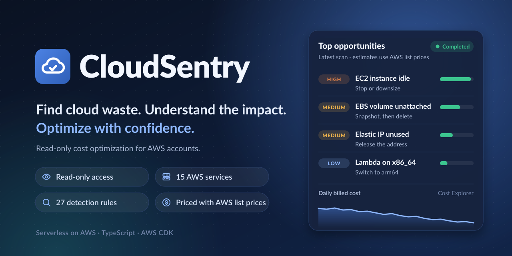
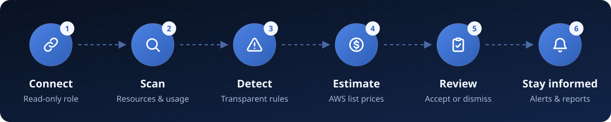
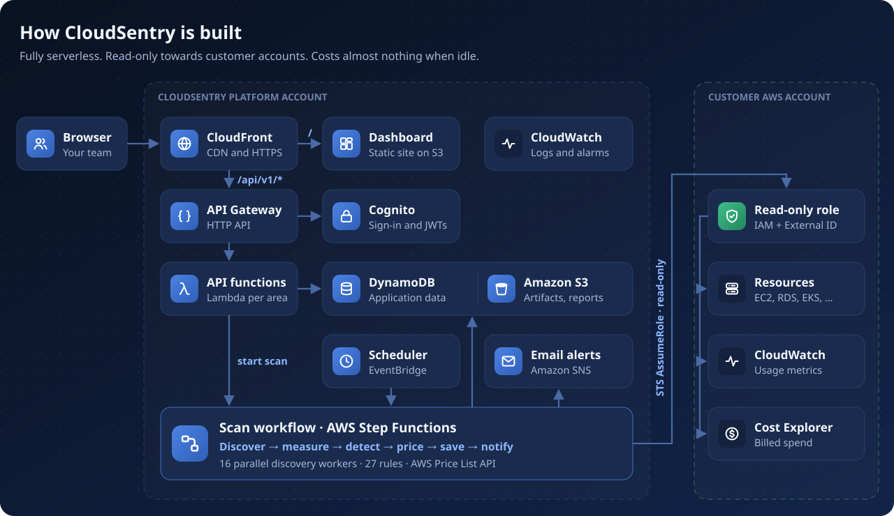
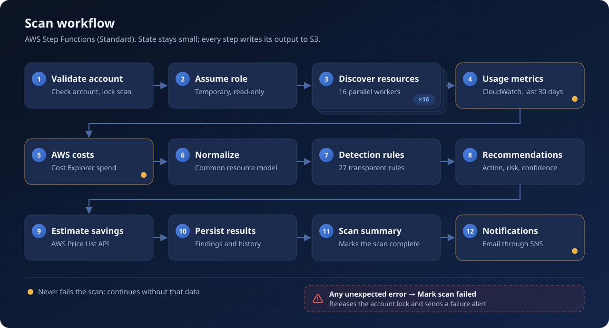

<p align="center">
  
</p>

# CloudSentry

**Find cloud waste. Understand the impact. Optimize with confidence.**

<p>
   <a href="docs/README.md">Documentation</a> &nbsp;·&nbsp;
   <a href="docs/architecture/overview.md">Architecture</a> &nbsp;·&nbsp;
   <a href="docs/deployment.md">Deploy to AWS</a> &nbsp;·&nbsp;
   <a href="docs/development.md">Run locally</a> &nbsp;·&nbsp;
   <a href="docs/api/README.md">API reference</a>
</p>

##  What is CloudSentry?

Companies that run on Amazon Web Services (AWS) often pay for things they no longer use: servers left running
after a project ended, disks that are not attached to anything, databases sized for traffic that never came,
backups kept forever. Each item is small, but together they can add up to a large part of the monthly bill, and
they are hard to find by hand.

CloudSentry finds that waste for you. You connect an AWS account, CloudSentry looks at what is running, how much
it is actually used and what it costs, and then gives you a clear list of things you could turn off, shrink or
clean up, with an estimate of how much money each change would save per month.

CloudSentry only **looks**. It never changes, stops or deletes anything in your account. Every suggestion is a
recommendation for a person to review and apply.

##  Who is it for?

| Reader                                                                                                                        | What CloudSentry gives you                                                                               |
| ----------------------------------------------------------------------------------------------------------------------------- | -------------------------------------------------------------------------------------------------------- |
|  Business owners, finance and managers | A simple view of cloud spend and a ranked list of savings opportunities in dollars per month.            |
|  Engineering and operations teams   | Evidence for each finding (usage metrics, configuration, thresholds) and step-by-step suggested actions. |
|  FinOps / cost teams                  | Scheduled scans, tracking of what was accepted or dismissed, and downloadable reports.                   |

##  How it works (in plain language)



1. **Connect an account safely.** You create a read-only access role in your AWS account using a ready-made
   template that CloudSentry generates. No passwords or secret keys are shared.
2. **Scan.** CloudSentry lists your resources in the regions you chose, reads their usage history (for example
   CPU or network activity over the last 30 days) and reads your actual bill from AWS Cost Explorer.
3. **Detect waste.** Fixed, transparent rules decide what looks idle, unused or oversized. If the data needed to
   decide is missing, CloudSentry says "not evaluated" instead of guessing.
4. **Estimate savings.** Each finding is priced with official AWS list prices. Estimates are always labelled as
   estimates, with the assumptions written out.
5. **Review and act.** Your team marks each recommendation as under review, accepted or dismissed. When a fix is
   made, the next scan notices and marks the finding resolved.
6. **Stay informed.** Scans can run on a schedule (daily, every 6 hours, weekly or custom), email alerts can be sent
   for important findings, and PDF or JSON reports can be downloaded.

##  What CloudSentry checks

CloudSentry covers 15 AWS services (16 resource types) with 27 detection rules.

| AWS service        | What it is                                  | What CloudSentry looks for                                                                                                                        |
| ------------------ | ------------------------------------------- | ------------------------------------------------------------------------------------------------------------------------------------------------- |
| **EC2**            | Virtual servers                             | Servers that are running but almost idle (very low CPU and network use)                                                                           |
| **EBS volumes**    | Disks for servers                           | Disks that are not attached to any server                                                                                                         |
| **Elastic IP**     | Fixed public internet addresses             | Addresses that are reserved but not used (AWS charges for these)                                                                                  |
| **RDS**            | Managed relational databases                | Databases that are much bigger than their workload, or not used at all                                                                            |
| **EBS snapshots**  | Backup copies of disks                      | Very old snapshots that may no longer be needed (backup-managed ones are skipped)                                                                 |
| **NAT Gateway**    | Lets private servers reach the internet     | Gateways with almost no traffic                                                                                                                   |
| **Load balancers** | Spread web traffic across servers           | Listed in the inventory (no waste rule yet)                                                                                                       |
| **Lambda**         | Code that runs on demand                    | Too much memory allocated, functions that could run cheaper on arm64 (Graviton), idle provisioned concurrency, runs that come close to timing out |
| **EKS**            | Kubernetes container clusters               | Clusters with no worker nodes, under-used nodes, pods reserving far more resources than they use                                                  |
| **ElastiCache**    | In-memory caches (Redis, Valkey, Memcached) | Oversized or completely idle cache clusters                                                                                                       |
| **CloudFront**     | Content delivery network                    | Distributions with almost no traffic, busy distributions with compression turned off                                                              |
| **EFS**            | Shared network file storage                 | File systems nobody uses, large file systems without a cheaper storage tier policy                                                                |
| **DynamoDB**       | NoSQL database tables                       | Too much reserved capacity, spiky tables that would be cheaper on on-demand pricing, unused tables                                                |
| **Redshift**       | Data warehouse                              | Clusters with no connections, clusters idle long enough to pause on a schedule                                                                    |
| **AWS Backup**     | Backup plans and stored backups             | Backups kept forever or beyond a retention limit, the same resource backed up by several plans                                                    |

Some rules need optional AWS monitoring features: Lambda memory checks need **Lambda Insights**, and EKS node and
pod checks need **Container Insights**. Without them, those rules report "not evaluated".

##  Safe and honest by design

- **Read-only access.** The access role only allows "describe", "list" and "get" actions. CloudSentry cannot
  modify resources and never reads your data (for example, it never reads database items or file contents).
- **No stored keys.** CloudSentry uses temporary AWS credentials that expire after an hour and are never saved.
- **Protected connection.** Each connection uses a unique secret value (an "external ID") so no one else can use
  CloudSentry to access your account.
- **No invented numbers.** Spend comes from your AWS bill. Savings come from official AWS prices and are always
  marked as estimates. Missing usage data is shown as "no data", never as zero.
- **Separated customers.** Each organization only ever sees its own accounts and results.
- **Clearly labelled sample data.** Demo data created for local development is marked "Synthetic" everywhere.

##  What you see in the dashboard

| Page                                                                                                        | Shows                                                                                               |
| ----------------------------------------------------------------------------------------------------------- | --------------------------------------------------------------------------------------------------- |
|  Overview        | Month-to-date spend, potential monthly savings, findings by severity, cost trend, top opportunities |
|  Cloud Accounts      | Connected accounts, a guided connection wizard, connection health, rename and remove                |
|  Resources          | Every discovered resource with usage, tags and related findings                                     |
|  Cost Analytics      | Monthly and daily spend, cost by service and region, month-over-month change, unusual spikes        |
|  Findings            | Detected issues with evidence, severity and history                                                 |
|  Recommendations | Suggested actions, estimated savings, confidence and risk; accept, dismiss or review                |
|  Scan History      | Every scan with its steps, results and any errors                                                   |
|  Reports              | Downloadable PDF and JSON reports                                                                   |
|  Settings          | Scan schedules, email notifications, detection thresholds, profile                                  |

##  Key terms

| Term               | Meaning                                                                                         |
| ------------------ | ----------------------------------------------------------------------------------------------- |
| Scan               | One full check of an AWS account.                                                               |
| Finding            | Something CloudSentry detected, such as "this disk is not attached to anything".                |
| Recommendation     | The suggested action for a finding, with estimated savings, confidence and risk.                |
| Billed cost        | What AWS actually charged, read from AWS Cost Explorer. Current-month figures can still change. |
| Estimated savings  | CloudSentry's calculation of the monthly saving if you apply a recommendation. Not guaranteed.  |
| Cross-account role | The read-only access role you create in your AWS account for CloudSentry.                       |

##  Architecture (for technical readers)

CloudSentry is fully serverless and costs almost nothing when idle.





<details>
<summary>Text version of the architecture</summary>

```
Browser
  |
  v
CloudFront ---- /            --> S3 (static Next.js dashboard)
  |
  +------------ /api/v1/*    --> API Gateway (HTTP API, Cognito authorizer)
                                   |
                                   v
                                 Lambda (one function per API area) --> DynamoDB, S3, Cognito
                                   |
                                   v  start scan
                                 Step Functions scan workflow
                                   ValidateAccount -> AssumeCustomerRole -> 16 parallel discovery workers
                                   -> CloudWatch metrics -> Cost Explorer -> normalize -> detection rules
                                   -> recommendations -> Price List savings -> persist -> summary -> SNS email

EventBridge Scheduler --> scheduled-scan Lambda --> same scan workflow
```

</details>

| AWS service                            | Role in CloudSentry                                                              |
| -------------------------------------- | -------------------------------------------------------------------------------- |
| AWS Lambda                             | All compute: API handlers and every scan step                                    |
| Amazon API Gateway (HTTP API)          | REST API with Cognito JWT authorization and throttling                           |
| AWS Step Functions                     | Orchestrates scans with parallel discovery, retries and partial-failure handling |
| Amazon DynamoDB                        | Single-table, tenant-isolated application data                                   |
| Amazon S3                              | Dashboard hosting, scan artifacts and reports                                    |
| Amazon CloudFront                      | Serves the dashboard and API on one domain with security headers                 |
| Amazon Cognito                         | User sign-up and sign-in                                                         |
| Amazon EventBridge Scheduler           | Scheduled scans                                                                  |
| Amazon SNS                             | Email notifications and operational alarms                                       |
| AWS Secrets Manager                    | Cognito client secret                                                            |
| Amazon CloudWatch                      | Logs, metrics, alarms, dashboard; also the source of utilization data            |
| AWS STS, Cost Explorer, Price List API | Cross-account access, billed costs, list prices                                  |

Everything is defined in TypeScript with the AWS CDK (`infrastructure/`). Built with pnpm and Turborepo:
Next.js 15 dashboard, Node.js 22 Lambdas, AWS SDK v3, Zod validation, Vitest tests.

##  Project status

| Area                                                                                       | State                                                                                                                                                |
| ------------------------------------------------------------------------------------------ | ---------------------------------------------------------------------------------------------------------------------------------------------------- |
| Dashboard, API, scan workflow, 27 rules, savings engine, reports, schedules, notifications | Implemented                                                                                                                                          |
| Automated tests                                                                            | About 500 tests (unit + integration on DynamoDB Local with mocked AWS SDK clients). One validators test currently fails (pending `parseEnv` change). |
| AWS Price List integration                                                                 | Verified live: all 29 price queries return prices in us-east-1, eu-west-1 and ap-south-1                                                             |
| AWS CDK infrastructure                                                                     | `cdk synth` succeeds for all 6 stacks; **not yet deployed**                                                                                          |
| Docker image (local demo)                                                                  | Builds and runs (`docker compose up`); account creation without AWS credentials fixed but not yet re-checked in the container                        |
| Real scan of a live AWS account                                                            | **Not yet verified**                                                                                                                                 |

##  Getting started

###  Run locally (development)

Prerequisites: Node.js 22, pnpm 9, Docker (for DynamoDB Local).

```bash
pnpm install
pnpm dev:db           # DynamoDB Local on :8000
pnpm dev:api          # API on http://127.0.0.1:4000 (local sign-in, files stored under .local/)
pnpm dev:web          # Dashboard on http://localhost:3000
```

Register in the dashboard; locally the email confirmation code is printed in the API log. To explore with clearly
labelled sample data: `pnpm seed:synthetic -- --email you@example.com`. Details: [docs/development.md](docs/development.md).

###  Run with Docker (local demo)

```bash
docker compose up -d --build     # dashboard + API on http://localhost:8080, with DynamoDB Local
docker compose logs -f app       # shows the email confirmation code
```

To scan real AWS accounts from the container, add `-f docker-compose.aws.yml` with a non-root `AWS_PROFILE`.

###  Deploy to AWS (serverless)

See [docs/deployment.md](docs/deployment.md). Use a non-root IAM identity:

```bash
pnpm --filter @cloudsentry/web build
pnpm cdk bootstrap aws://<ACCOUNT_ID>/us-east-1
pnpm cdk deploy --all -c stage=dev
```

###  Quality checks

```bash
pnpm typecheck && pnpm lint && pnpm test      # add --concurrency=1 on low-memory machines
pnpm audit:deps
pnpm --filter @cloudsentry/recommendation verify:pricing us-east-1   # live Price List check (read-only)
```

##  Repository layout

```
apps/web                 Next.js dashboard (static export)
services/api             REST API (one Lambda per area), local dev server, container server, synthetic seed
services/scanner         Scan workflow steps, discovery, CloudWatch metrics, Cost Explorer
services/analyzer        Detection rules
services/recommendation  Recommendations, AWS Price List pricing, savings estimates
services/reporting       PDF and JSON reports
packages/*               Shared types, validators, utilities, AWS clients, DynamoDB repositories, core services
infrastructure           AWS CDK app (Data, Auth, Workflow, Api, Web, Observability stacks)
tests                    Cross-package integration tests
docs                     Architecture, security, API, decisions, deployment
```

##  Documentation

Start at the [documentation home](docs/README.md), or jump straight in:

|                                                                                            | Guide                                                                                 |                                        |
| ------------------------------------------------------------------------------------------ | ------------------------------------------------------------------------------------- | -------------------------------------- |
|    | [Architecture overview and contracts](docs/architecture/overview.md)                  | How the pieces fit together            |
|    | [Supported services contract](docs/architecture/extended-services.md)                 | Every AWS service CloudSentry scans    |
|  | [Discovery and metrics](docs/architecture/discovery-and-metrics.md)                   | Finding resources, usage and costs     |
|     | [Detection rules](docs/architecture/detection-rules.md)                               | What counts as waste, and why          |
|    | [Savings estimation](docs/architecture/savings-estimation.md)                         | How savings are priced                 |
|    | [API reference](docs/api/README.md)                                                   | REST endpoints (v1)                    |
|    | [Security overview](docs/security/overview.md) and [IAM design](docs/security/iam.md) | Threats, controls and every permission |
|      | [Architecture decision records](docs/decisions/)                                      | Why things are built this way          |
|  | [Local development](docs/development.md)                                              | Run everything on your machine         |
|    | [Deployment](docs/deployment.md)                                                      | Deploy the serverless stacks to AWS    |
