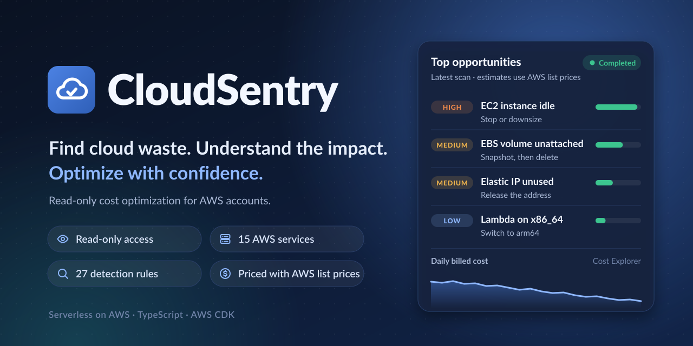
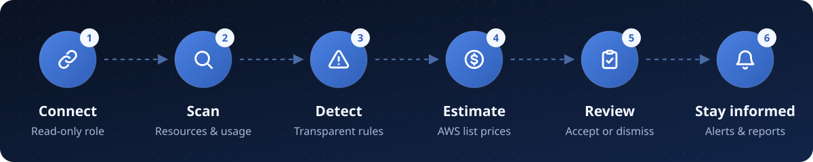
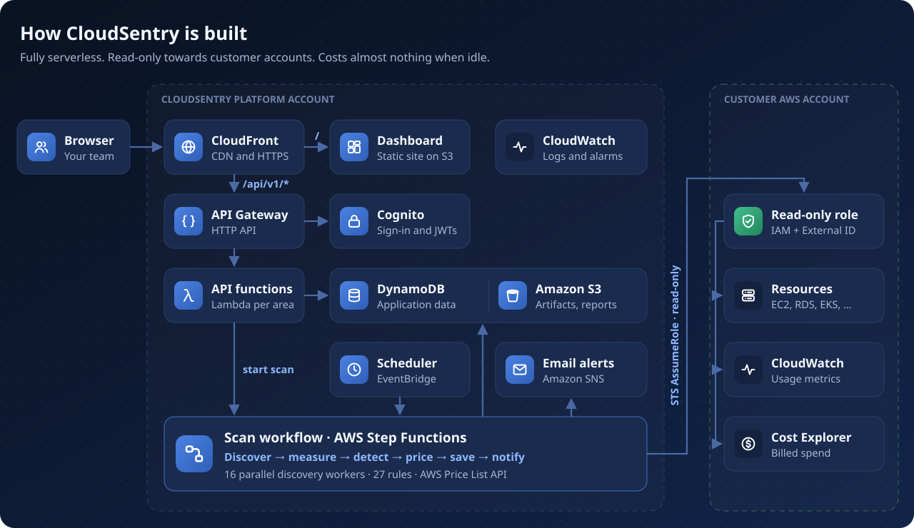
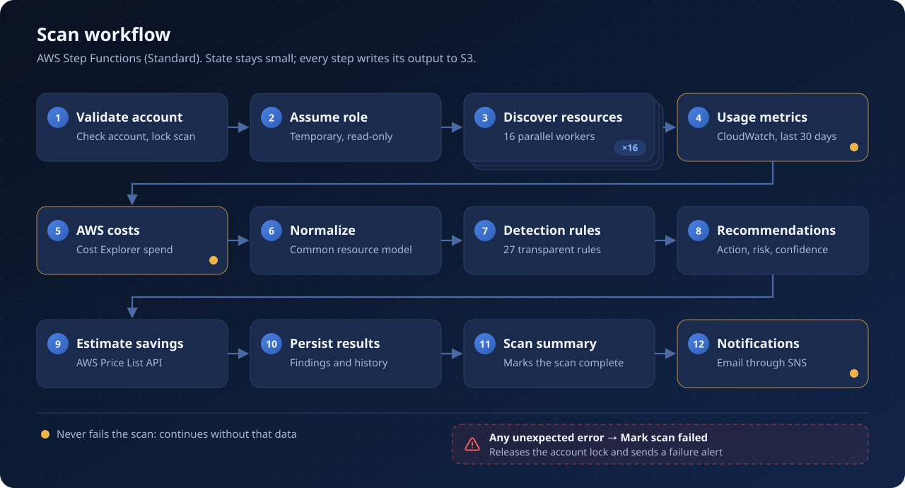

# CloudSentry documentation

Everything about how CloudSentry works, how to run it, and how it keeps connected AWS accounts safe. New to
CloudSentry? The [project README](../README.md) gives a plain-language introduction first.

##  Get started

|                                                                                       |                                     |                                                      |
| ------------------------------------------------------------------------------------- | ----------------------------------- | ---------------------------------------------------- |
|  | [Local development](development.md) | Run the dashboard, API and database on your machine  |
|     | [Deployment](deployment.md)         | Deploy the six serverless stacks to AWS with the CDK |

##  How it works

|                                                                                       |                                                                |                                                               |
| ------------------------------------------------------------------------------------- | -------------------------------------------------------------- | ------------------------------------------------------------- |
|    | [Architecture overview](architecture/overview.md)              | Layers, packages, data model, scan workflow and API contracts |
|    | [Supported services](architecture/extended-services.md)        | Every AWS service and resource type CloudSentry scans         |
|  | [Discovery and metrics](architecture/discovery-and-metrics.md) | How resources, usage metrics and costs are collected          |
|     | [Detection rules](architecture/detection-rules.md)             | What counts as waste, and the thresholds behind each rule     |
|    | [Savings estimation](architecture/savings-estimation.md)       | How recommendations are priced with AWS list prices           |

##  Security

|                                                                                     |                                           |                                                              |
| ----------------------------------------------------------------------------------- | ----------------------------------------- | ------------------------------------------------------------ |
|  | [Security overview](security/overview.md) | The main threats and the controls against them               |
|     | [IAM and authentication](security/iam.md) | Every permission on both sides of the cross-account boundary |

##  Reference

|                                                                                     |                                |                                            |
| ----------------------------------------------------------------------------------- | ------------------------------ | ------------------------------------------ |
|  | [API reference](api/README.md) | REST API v1: endpoints, errors, pagination |
|    | [Decision records](decisions/) | Why CloudSentry is built the way it is     |

##  Architecture at a glance

##  Images and icons

The cover, banner, diagrams and icons in [`assets/`](assets/) are generated by
[`scripts/generate-doc-assets.mjs`](../scripts/generate-doc-assets.mjs). Edit the script, not the SVG files, then run
`pnpm docs:assets`. `assets/cover.png` (1280 × 640) can also be uploaded as the repository's social preview image
(GitHub: **Settings → General → Social preview**).
