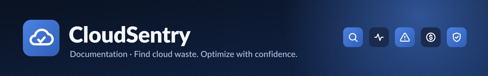

# CloudSentry API reference (v1)

Base URL: `https://<dashboard-domain>/api/v1` (CloudFront routes `/api/*` to API Gateway). Locally:
`http://127.0.0.1:4000/api/v1`. All bodies are JSON (`Content-Type: application/json`, max 64 KB).

Types referenced below are defined in `packages/shared-types/src`. Request schemas are in
`packages/validators/src/api.ts` and are the source of truth for field rules.

## Conventions

**Authentication.** Every route except `/auth/register`, `/auth/confirm`, `/auth/resend-code`, `/auth/login`,
`/auth/refresh` and `/auth/logout` requires `Authorization: Bearer <accessToken>`. Access tokens are Cognito
access tokens (1 hour). The refresh token is only ever stored in the `cs_refresh` cookie
(`HttpOnly; Secure; SameSite=Strict; Path=/api/v1/auth`). Cookie-authenticated endpoints (`/auth/refresh`,
`/auth/logout`) also require the header `X-CloudSentry-Client: web` (CSRF guard).

**Tenancy.** The caller's tenant is resolved server-side from the token subject. No endpoint accepts a tenant ID.
IDs belonging to another tenant return `404`.

**Roles.** `VIEWER` read-only. `MEMBER` may start/cancel scans, triage findings and recommendations, create
reports. `ADMIN` and `OWNER` may also manage accounts, schedules and settings. Insufficient role returns `403`.

**Envelopes.**

```json
{ "data": { } }
{ "data": [ ], "nextCursor": "opaque-or-null" }
{ "error": { "code": "VALIDATION_ERROR", "message": "...", "details": [{ "path": "accountId", "message": "..." }], "requestId": "..." } }
```

**Pagination.** `limit` (1-100, default 25) and `cursor` (from `nextCursor`). Cursors are opaque; forged or
cross-tenant cursors are rejected with `400`.

**Status codes.** `200` ok, `201` created, `202` accepted (async work started), `204` no content, `400` validation,
`401` unauthenticated, `403` forbidden / unconfirmed user, `404` not found, `405` method not allowed,
`409` conflict (duplicate, scan already running, auth challenge unsupported), `412` precondition failed
(stale `expectedVersion`, account not verified, report not ready), `429` throttled, `500` internal, `502` upstream AWS failure.

Every response carries `x-request-id`. Send `x-correlation-id` to have it logged with the request.

## Auth

| Method | Path                | Body                                          | Response                                       |
| ------ | ------------------- | --------------------------------------------- | ---------------------------------------------- |
| POST   | `/auth/register`    | `{ email, password, name, organizationName }` | `201 { userConfirmed }`                        |
| POST   | `/auth/confirm`     | `{ email, code }`                             | `200 { confirmed: true }`                      |
| POST   | `/auth/resend-code` | `{ email }`                                   | `202`                                          |
| POST   | `/auth/login`       | `{ email, password }`                         | `200 LoginResponse` + `Set-Cookie: cs_refresh` |
| POST   | `/auth/refresh`     | none (cookie + CSRF header)                   | `200 { accessToken, expiresIn, tokenType }`    |
| POST   | `/auth/logout`      | none (cookie + CSRF header)                   | `204`, refresh token revoked, cookie cleared   |
| GET    | `/auth/me`          |                                               | `200 MeResponse`                               |

The first successful login creates the tenant (named after `organizationName`) with the user as `OWNER`.
Password policy: 12+ characters with lower, upper, digit and symbol. MFA and forced-password-change challenges
return `409 AUTH_CHALLENGE_UNSUPPORTED` in this version.

## Accounts

| Method | Path                              | Notes                                                                                                                                                                                                                                                                                                            |
| ------ | --------------------------------- | ---------------------------------------------------------------------------------------------------------------------------------------------------------------------------------------------------------------------------------------------------------------------------------------------------------------- |
| POST   | `/accounts`                       | `{ accountId, alias, roleName?='CloudSentryReadOnlyRole', regions?=['us-east-1'] }` -> `201 CreateAccountResponse` (account + onboarding: external ID, CloudFormation template, CLI command, trust and permission policies). The external ID is generated server-side. Role names must start with `CloudSentry`. |
| GET    | `/accounts`                       | `{ data: CloudAccount[] }`                                                                                                                                                                                                                                                                                       |
| GET    | `/accounts/:accountId`            |                                                                                                                                                                                                                                                                                                                  |
| PATCH  | `/accounts/:accountId`            | `{ alias?, regions? }`                                                                                                                                                                                                                                                                                           |
| DELETE | `/accounts/:accountId`            | `204`. Removes schedule, inventory, findings, recommendations, cost data. Scan history is kept. `409` while a scan runs.                                                                                                                                                                                         |
| GET    | `/accounts/:accountId/onboarding` | Re-display setup instructions                                                                                                                                                                                                                                                                                    |
| POST   | `/accounts/:accountId/verify`     | `{ roleArn? }` -> account with `status` CONNECTED/ERROR and `lastVerification` (AssumeRole, account match, per-permission checks)                                                                                                                                                                                |

## Scans

| Method | Path                         | Notes                                                                                                                                                                                                                                              |
| ------ | ---------------------------- | -------------------------------------------------------------------------------------------------------------------------------------------------------------------------------------------------------------------------------------------------- |
| POST   | `/accounts/:accountId/scans` | `{ regions? }` (subset of the account's regions). Optional `Idempotency-Key` header (8-128 chars): a replay returns `200` with the original scan. New scan: `202 ScanExecution`. `409` if a scan is running; `412` if the account is not verified. |
| GET    | `/scans`                     | `?accountId&status&limit&cursor`, newest first                                                                                                                                                                                                     |
| GET    | `/scans/:scanId`             | Steps, discovery results per type/region, summary, errors                                                                                                                                                                                          |
| GET    | `/scans/:scanId/results`     | `ScanResultsResponse`: scan + findings/recommendations last touched by this scan                                                                                                                                                                   |
| POST   | `/scans/:scanId/cancel`      | Stops the execution; `409` if already terminal                                                                                                                                                                                                     |

Scan statuses: `PENDING`, `RUNNING`, `PARTIALLY_COMPLETED`, `COMPLETED`, `FAILED`, `CANCELLED`.

## Inventory

| Method | Path                                 | Notes                                                                                                            |
| ------ | ------------------------------------ | ---------------------------------------------------------------------------------------------------------------- |
| GET    | `/resources`                         | `?accountId&resourceType=A,B&region=us-east-1,eu-west-1&state&search&hasFindings&includeNotFound&sort=lastSeenAt | name                    | resourceType                                                          | region                                | activeFindingCount&order=asc | desc&limit&cursor` |
| GET    | `/resources/:resourceKey`            | `ResourceDetailResponse` (resource, findings, recommendations)                                                   |
| GET    | `/findings`                          | `?accountId&resourceType&severity&category&status&resourceKey&limit&cursor`                                      |
| GET    | `/findings/:findingId`               |                                                                                                                  |
| PATCH  | `/findings/:findingId`               | `{ status: OPEN                                                                                                  | ACKNOWLEDGED            | SUPPRESSED, note?, expectedVersion? }`. `RESOLVED` is system-managed. |
| GET    | `/recommendations`                   | `?accountId&resourceType&status&minMonthlySavings&sort=savings                                                   | updatedAt&limit&cursor` |
| GET    | `/recommendations/:recommendationId` |                                                                                                                  |
| PATCH  | `/recommendations/:recommendationId` | `{ status: OPEN                                                                                                  | UNDER_REVIEW            | ACCEPTED                                                              | DISMISSED, note?, expectedVersion? }` |

Status changes are audit-logged and update the stored record (no resource in AWS is changed).

## Analytics

| Method | Path                                      | Response            |
| ------ | ----------------------------------------- | ------------------- |
| GET    | `/analytics/overview?accountId`           | `OverviewAnalytics` |
| GET    | `/analytics/costs?accountId&months=1..12` | `CostAnalytics`     |
| GET    | `/analytics/resources?accountId`          | `ResourceAnalytics` |
| GET    | `/analytics/savings?accountId`            | `SavingsAnalytics`  |

Spend values are Cost Explorer `UnblendedCost` (actual billed; `unfinalized` for open periods). Savings values
are estimates. `syntheticCostIncluded` is true when local synthetic data is part of a total.

## Schedules

| Method | Path                     | Notes                                                                         |
| ------ | ------------------------ | ----------------------------------------------------------------------------- |
| POST   | `/schedules`             | `{ accountId, frequency: DAILY                                                | EVERY_6_HOURS | WEEKLY | CUSTOM, hour?, minute?, dayOfWeek? (1=Sun..7=Sat), cronExpression? (EventBridge cron, required for CUSTOM), timezone?='UTC', enabled?=true }`->`201`. One schedule per account (`409` otherwise). |
| GET    | `/schedules?accountId`   | Includes computed `nextExecutionAt`, `lastExecutionAt`, `lastExecutionStatus` |
| GET    | `/schedules/:scheduleId` |                                                                               |
| PATCH  | `/schedules/:scheduleId` | Any subset of the create fields except `accountId`                            |
| DELETE | `/schedules/:scheduleId` | `204`                                                                         |

## Reports

| Method | Path                          | Notes                                                             |
| ------ | ----------------------------- | ----------------------------------------------------------------- |
| POST   | `/reports`                    | `{ accountId?: string                                             | null, type?: ON_DEMAND | WEEKLY | MONTHLY, format?: PDF | JSON }`->`202 ReportRecord` (status PENDING) |
| GET    | `/reports`                    | Newest first                                                      |
| GET    | `/reports/:reportId`          | Status PENDING, GENERATING, READY or FAILED                       |
| GET    | `/reports/:reportId/download` | `{ url, expiresAt }`, pre-signed for 5 minutes; `412` until READY |

## Settings and rules

| Method  | Path                      | Notes                                                                                                                         |
| ------- | ------------------------- | ----------------------------------------------------------------------------------------------------------------------------- |
| GET/PUT | `/settings/notifications` | `NotificationPreferences`. PUT subscribes emails to the SNS topic with a `tenantId` filter policy; recipients must confirm.   |
| GET/PUT | `/settings/detection`     | `{ lookbackDays 14..90, ignoreTagKey, rules: { [ruleId]: { enabled, thresholds } } }`. Unknown rules/thresholds are rejected. |
| GET     | `/rules`                  | `RuleDefinitionSummary[]`                                                                                                     |
