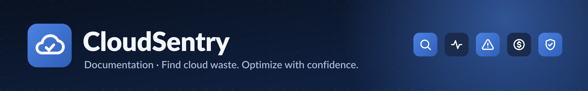
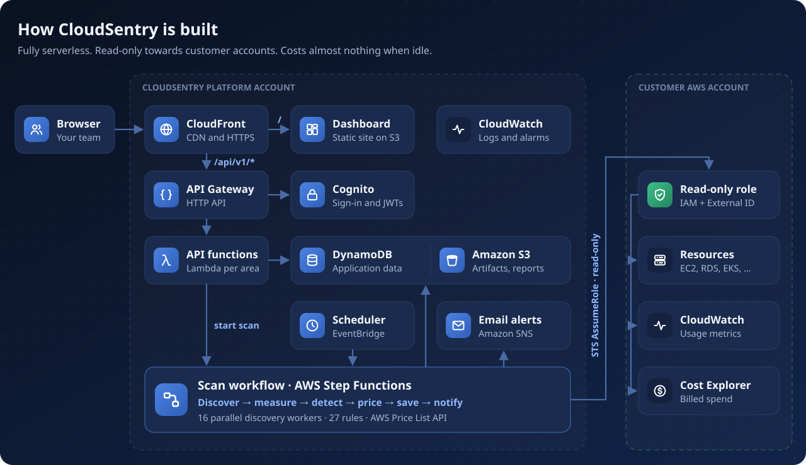
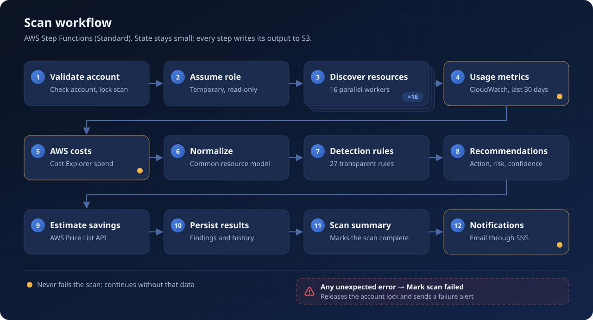

# CloudSentry Architecture

CloudSentry is a read-only AWS FinOps platform. It assumes a customer-deployed IAM role, discovers
resources, collects CloudWatch utilization and Cost Explorer spend, runs deterministic waste-detection
rules, prices savings with the AWS Price List API, and presents findings and recommendations in a dashboard.

This document is the authoritative contract between components. Component owners must not change the
contracts below without updating this file.

## 1. Layers



```
Browser (Next.js static export, served by CloudFront)
   |  same origin: /            -> S3 (static site, OAC)
   |               /api/v1/*    -> API Gateway HTTP API
   v
API Gateway HTTP API  --JWT authorizer (Cognito access token)-->  domain Lambdas
   |   auth | accounts | scans | inventory | analytics | schedules | reports | settings
   |
   +--> DynamoDB (single table)        +--> S3 artifacts bucket (scan artifacts, reports)
   +--> Step Functions (StartExecution) +--> EventBridge Scheduler (per-account schedules)
   +--> SNS (tenant-filtered notifications topic)

EventBridge Scheduler --> scheduled-scan-trigger Lambda --> same ScanService.startScan() as manual scans
Step Functions Standard workflow --> scanner / analyzer / recommendation Lambdas (see section 4)
```

Key decisions (details in `docs/decisions/`):

| Decision          | Choice                                                                                                 | Why                                                                                              |
| ----------------- | ------------------------------------------------------------------------------------------------------ | ------------------------------------------------------------------------------------------------ |
| API style         | HTTP API + one Lambda per domain                                                                       | Least privilege per function, small bundles, independent deploys; avoids one monolithic handler. |
| Frontend hosting  | Next.js static export on S3 + CloudFront, API under the same origin                                    | No server to operate; httpOnly refresh cookie works same-origin; no CORS.                        |
| Auth              | Cognito user pool, backend-mediated login (USER_PASSWORD_AUTH with client secret from Secrets Manager) | Required `/auth/login` endpoint; refresh token never touches JavaScript (httpOnly cookie).       |
| Tenant resolution | `sub` -> `USER#<sub>` profile item -> `tenantId`                                                       | Never trust tenant IDs from tokens or request input.                                             |
| Database          | DynamoDB single table + 1 GSI                                                                          | Every access pattern is tenant-scoped; partition keys all start with `TENANT#<id>`.              |
| Workflow payloads | Small state; data in S3 artifacts                                                                      | Avoids the 256 KB Step Functions limit; credentials never enter state/execution history.         |
| Credentials       | Each Lambda that needs customer access performs its own AssumeRole                                     | Temporary credentials stay in memory; nothing sensitive in workflow history.                     |
| Pricing           | AWS Price List API with DynamoDB cache                                                                 | No invented prices; unavailable prices produce `UNAVAILABLE` estimates.                          |

## 2. Packages

| Package                   | Responsibility                                                                                                                                                                 |
| ------------------------- | ------------------------------------------------------------------------------------------------------------------------------------------------------------------------------ |
| `packages/shared-types`   | Domain types, enums, workflow and artifact contracts, customer IAM permission list. No runtime deps.                                                                           |
| `packages/utilities`      | Logger (JSON, redaction, audit), typed errors, retry/backoff, concurrency, ids, stats, cursors.                                                                                |
| `packages/validators`     | Zod schemas for API input, env config, AWS identifiers, cron expressions.                                                                                                      |
| `packages/aws-clients`    | Client defaults (adaptive retry, timeouts), cross-account credentials, `CustomerAwsClients`, `StsRoleVerifier`, `ArtifactStore` (S3 + local filesystem).                       |
| `packages/database`       | DynamoDB key design and repositories. Business logic never builds keys.                                                                                                        |
| `packages/core`           | Application services shared by API and workers: auth, accounts, scans, schedules, findings/recommendation lifecycle, analytics, settings, notifications. Ports + AWS adapters. |
| `services/scanner`        | Workflow step handlers, discovery modules (one per resource type), metric collection, Cost Explorer analysis, normalization.                                                   |
| `services/analyzer`       | Deterministic rule engine and rules. Pure functions + detection handler.                                                                                                       |
| `services/recommendation` | Recommendation generation, pricing engine (Price List API provider + cache), savings estimation.                                                                               |
| `services/reporting`      | Report data assembly and PDF/JSON rendering; async report Lambda.                                                                                                              |
| `services/api`            | HTTP routing, auth middleware, domain handlers, local dev server, synthetic seed.                                                                                              |
| `apps/web`                | Dashboard.                                                                                                                                                                     |
| `infrastructure`          | AWS CDK app.                                                                                                                                                                   |

Dependency direction: `shared-types <- utilities <- validators <- aws-clients/database <- core <- services <- api`.
Services never import each other at runtime except: `api/src/local/*` (local development only) imports the
worker services to run the workflow in-process.

## 3. DynamoDB single-table design

Table `cloudsentry-<stage>-main`. Attributes: `PK`, `SK`, `GSI1PK`, `GSI1SK`, `expiresAt` (TTL, epoch seconds),
`entity` (type discriminator), plus the record fields. GSI1 projects ALL.

| Entity               | PK                           | SK                                             | GSI1PK / GSI1SK                                                     | Notes                                                                             |
| -------------------- | ---------------------------- | ---------------------------------------------- | ------------------------------------------------------------------- | --------------------------------------------------------------------------------- |
| Tenant               | `TENANT#<t>`                 | `META`                                         |                                                                     |                                                                                   |
| User profile         | `USER#<sub>`                 | `PROFILE`                                      | `TENANT#<t>#USERS` / `USER#<sub>`                                   | Authoritative tenant lookup by subject.                                           |
| Pending registration | `REGISTRATION#<email>`       | `PENDING`                                      |                                                                     | TTL 7 days. Holds org name until first login provisions the tenant.               |
| Cloud account        | `TENANT#<t>`                 | `ACCOUNT#<awsAccountId>`                       |                                                                     | Conditional put prevents duplicates per tenant.                                   |
| Active scan lock     | `TENANT#<t>`                 | `LOCK#SCAN#<accountId>`                        |                                                                     | TTL 3 h. Prevents concurrent scans of one account.                                |
| Idempotency key      | `TENANT#<t>`                 | `IDEMPOTENCY#<key>`                            |                                                                     | TTL 24 h. Maps a client key to a scanId.                                          |
| Scan execution       | `TENANT#<t>`                 | `SCAN#<scanId>`                                | `TENANT#<t>#ACCOUNT#<a>#SCANS` / `SCAN#<scanId>`                    | scanId is a ULID, so SK order = time order.                                       |
| Resource             | `TENANT#<t>#RESOURCES`       | `RES#<accountId>#<region>#<type>#<resourceId>` | `TENANT#<t>#RTYPE#<type>` / `RES#<accountId>#<region>#<resourceId>` | `resourceKey` = base64url(account\|region\|type\|id) decodes to the SK.           |
| Finding              | `TENANT#<t>#FINDINGS`        | `FINDING#<findingId>`                          | `TENANT#<t>#RESOURCE#<resourceKey>` / `FINDING#<findingId>`         | findingId = hash(account, region, rule, resource): dedup by construction.         |
| Recommendation       | `TENANT#<t>#RECOMMENDATIONS` | `REC#<recommendationId>`                       | `TENANT#<t>#RESOURCE#<resourceKey>` / `REC#<recommendationId>`      | recommendationId = hash(findingId).                                               |
| Cost snapshot        | `TENANT#<t>`                 | `COST#<accountId>`                             |                                                                     | Latest Cost Explorer snapshot per account. History in S3 (`costs.json` per scan). |
| Schedule             | `TENANT#<t>`                 | `SCHEDULE#<scheduleId>`                        |                                                                     | scheduleId = `sch_<accountId>`: one schedule per account (no duplicates).         |
| Report               | `TENANT#<t>`                 | `REPORT#<reportId>`                            |                                                                     |                                                                                   |
| Notification         | `TENANT#<t>#NOTIFICATIONS`   | `NTF#<notificationId>`                         |                                                                     | TTL 180 days.                                                                     |
| Notification dedupe  | `TENANT#<t>`                 | `NOTIFYKEY#<dedupeKey>`                        |                                                                     | Conditional put; TTL 90 days.                                                     |
| Notification prefs   | `TENANT#<t>`                 | `SETTINGS#NOTIFICATIONS`                       |                                                                     |                                                                                   |
| Detection settings   | `TENANT#<t>`                 | `SETTINGS#DETECTION`                           |                                                                     |                                                                                   |
| Price cache          | `PRICE#<hash>`               | `PRICE`                                        |                                                                     | Global (not tenant data). TTL 7 days (1 day for "no price found").                |

Tenant isolation rules:

1. Every repository method that reads tenant data takes `tenantId` as its first parameter and builds the key itself.
2. Pagination cursors are validated so their partition key starts with `TENANT#<caller tenant>`.
3. Lookups by ID (`GET /findings/:id`) are `GetItem` on the tenant's partition; another tenant's ID simply is not found.

Mutable records carry `version` and `updatedAt`. User-driven updates use `version` conditions (optimistic locking).

## 4. Scan workflow (Step Functions Standard)

State machine `cloudsentry-<stage>-scan`. Execution name = `scanId` (Step Functions rejects duplicate names: idempotent start).
State is small JSON (`ScanWorkflowState` in shared-types). Every step writes bulky output to S3 under
`scans/<tenantId>/<accountId>/<scanId>/` and returns `{ status, artifactKey }`. Reports are stored under
`reports/<tenantId>/<accountId|all>/<type>/<reportId>.<pdf|json>`. Separate top-level prefixes allow separate
lifecycle retention. (The spec's suggested `accounts/{accountId}/...` layout was extended with the tenant ID
because the same AWS account may be connected by more than one tenant.)



| State                     | Lambda handler (path relative to repo root)                                                                                                                                                                                                                   | Notes                                                                                                                                                                                                                                                                                                                           |
| ------------------------- | ------------------------------------------------------------------------------------------------------------------------------------------------------------------------------------------------------------------------------------------------------------- | ------------------------------------------------------------------------------------------------------------------------------------------------------------------------------------------------------------------------------------------------------------------------------------------------------------------------------- |
| ValidateAccount           | `services/scanner/src/handlers/validate-account.ts`                                                                                                                                                                                                           | Loads account, marks scan RUNNING, records execution ARN. ResultPath `$.validation`.                                                                                                                                                                                                                                            |
| AssumeCustomerRole        | `services/scanner/src/handlers/assume-role.ts`                                                                                                                                                                                                                | AssumeRole + GetCallerIdentity; returns no credentials. ResultPath `$.role`.                                                                                                                                                                                                                                                    |
| DiscoverResources         | `services/scanner/src/handlers/resolve-regions.ts`                                                                                                                                                                                                            | Intersects configured and enabled regions. ResultPath `$.regionsResolved`.                                                                                                                                                                                                                                                      |
| ParallelResourceDiscovery | `services/scanner/src/handlers/discover-{ec2,ebs,eip,rds,snapshots,nat-gateways,load-balancers,lambda-functions,eks-clusters,elasticache-clusters,cloudfront-distributions,efs-file-systems,dynamodb-tables,redshift-clusters,backup-plans,backup-vaults}.ts` | 16 Parallel branches (see `extended-services.md`; CloudFront is discovered once, region `global`). Workers receive `DiscoveryWorkerInput` (`{tenantId, accountId, scanId, trigger, regions, artifactsPrefix}`), not the full state. Each branch has Retry + Catch -> Pass `{status: FAILED}`. ResultPath `$.discovery` (array). |
| CollectCloudWatchMetrics  | `services/scanner/src/handlers/collect-metrics.ts`                                                                                                                                                                                                            | Catch -> continue (metrics unavailable). ResultPath `$.metrics`.                                                                                                                                                                                                                                                                |
| AnalyzeAWSCosts           | `services/scanner/src/handlers/analyze-costs.ts`                                                                                                                                                                                                              | Catch -> continue (cost unavailable). ResultPath `$.costs`.                                                                                                                                                                                                                                                                     |
| NormalizeResourceData     | `services/scanner/src/handlers/normalize-resources.ts`                                                                                                                                                                                                        | ResultPath `$.normalized`.                                                                                                                                                                                                                                                                                                      |
| ExecuteDetectionRules     | `services/analyzer/src/handlers/execute-detection-rules.ts`                                                                                                                                                                                                   | ResultPath `$.detection`.                                                                                                                                                                                                                                                                                                       |
| GenerateRecommendations   | `services/recommendation/src/handlers/generate-recommendations.ts`                                                                                                                                                                                            | ResultPath `$.recommendations`.                                                                                                                                                                                                                                                                                                 |
| EstimateSavings           | `services/recommendation/src/handlers/estimate-savings.ts`                                                                                                                                                                                                    | Calls the Price List API with CloudSentry's own role. ResultPath `$.savings`.                                                                                                                                                                                                                                                   |
| PersistResults            | `services/scanner/src/handlers/persist-results.ts`                                                                                                                                                                                                            | Upserts resources, merges finding/recommendation lifecycle. Idempotent per scanId. ResultPath `$.persisted`.                                                                                                                                                                                                                    |
| GenerateScanSummary       | `services/scanner/src/handlers/generate-summary.ts`                                                                                                                                                                                                           | Sets COMPLETED / PARTIALLY_COMPLETED, releases lock. ResultPath `$.summary`.                                                                                                                                                                                                                                                    |
| SendNotifications         | `services/scanner/src/handlers/send-notifications.ts`                                                                                                                                                                                                         | Catch -> Succeed (notification failure never fails a scan). ResultPath `$.notifications`.                                                                                                                                                                                                                                       |
| MarkScanFailed            | `services/scanner/src/handlers/mark-scan-failed.ts`                                                                                                                                                                                                           | Target of the global Catch (error at `$.error`, result at `$.markFailed`); sets FAILED unless already CANCELLED, releases lock, sends failure notification, then Fail state.                                                                                                                                                    |

Other Lambdas:

| Function               | Handler                                                   | Trigger                                                                                                        |
| ---------------------- | --------------------------------------------------------- | -------------------------------------------------------------------------------------------------------------- |
| scheduled-scan-trigger | `services/scanner/src/handlers/scheduled-scan-trigger.ts` | EventBridge Scheduler (input `{ tenantId, accountId, scheduleId }`)                                            |
| generate-report        | `services/reporting/src/handlers/generate-report.ts`      | Async invoke from reports API (`{ tenantId, reportId }`)                                                       |
| api-auth               | `services/api/src/handlers/auth.ts`                       | `/api/v1/auth/*` (no authorizer; login/register/refresh/logout are public, `/auth/me` verifies JWT in-handler) |
| api-accounts           | `services/api/src/handlers/accounts.ts`                   | `/api/v1/accounts*` except scans                                                                               |
| api-scans              | `services/api/src/handlers/scans.ts`                      | `POST /api/v1/accounts/{accountId}/scans`, `/api/v1/scans*`                                                    |
| api-inventory          | `services/api/src/handlers/inventory.ts`                  | `/api/v1/resources*`, `/api/v1/findings*`, `/api/v1/recommendations*`                                          |
| api-analytics          | `services/api/src/handlers/analytics.ts`                  | `/api/v1/analytics/*`                                                                                          |
| api-schedules          | `services/api/src/handlers/schedules.ts`                  | `/api/v1/schedules*`                                                                                           |
| api-reports            | `services/api/src/handlers/reports.ts`                    | `/api/v1/reports*`                                                                                             |
| api-settings           | `services/api/src/handlers/settings.ts`                   | `/api/v1/settings/*`, `GET /api/v1/rules`                                                                      |

Every handler module exports `handler`. Retries: Lambda service errors (`Lambda.ServiceException`,
`Lambda.TooManyRequestsException`, `Lambda.SdkClientException`, `Lambda.AWSLambdaException`) retry with
`IntervalSeconds: 2, BackoffRate: 2, MaxAttempts: 4, JitterStrategy: FULL`. Step-level business errors are
reported inside the result (status PARTIAL/FAILED) rather than thrown, so one failed region never fails a scan.

### Environment variables

| Variable                                                                    | Used by                           | Meaning                                                                        |
| --------------------------------------------------------------------------- | --------------------------------- | ------------------------------------------------------------------------------ |
| `STAGE`                                                                     | all                               | `dev`, `staging`, `prod`, or `local`                                           |
| `LOG_LEVEL`                                                                 | all                               | debug/info/warn/error                                                          |
| `TABLE_NAME`                                                                | all                               | DynamoDB table                                                                 |
| `ARTIFACTS_BUCKET`                                                          | all                               | S3 bucket for artifacts/reports                                                |
| `PLATFORM_ACCOUNT_ID`                                                       | api-accounts                      | Account customers trust in their role trust policy                             |
| `PRICING_REGION`                                                            | estimate-savings                  | Price List API endpoint region (us-east-1)                                     |
| `AUTH_MODE`                                                                 | api-*                             | `cognito` (deployed) or `local` (local dev only; refused unless `STAGE=local`) |
| `USER_POOL_ID`, `USER_POOL_CLIENT_ID`, `USER_POOL_CLIENT_SECRET_ARN`        | api-*                             | Cognito                                                                        |
| `STATE_MACHINE_ARN`                                                         | api-scans, scheduled-scan-trigger | Scan workflow                                                                  |
| `SCHEDULER_GROUP_NAME`, `SCHEDULER_ROLE_ARN`, `SCHEDULED_SCAN_FUNCTION_ARN` | api-schedules, api-accounts       | EventBridge Scheduler                                                          |
| `NOTIFICATIONS_TOPIC_ARN`                                                   | api-settings, send-notifications  | SNS topic                                                                      |
| `REPORT_FUNCTION_NAME`                                                      | api-reports                       | generate-report function                                                       |
| `METRICS_REUSE_HOURS`, `COST_REFRESH_HOURS`                                 | collect-metrics, analyze-costs    | Reuse windows                                                                  |
| `DASHBOARD_URL`                                                             | send-notifications                | Links in notifications                                                         |

### IAM summary (CloudSentry side)

- Lambdas that touch customer accounts (`validate-account` no; `assume-role`, `resolve-regions`, all `discover-*`,
  `collect-metrics`, `analyze-costs`, `api-accounts`) get `sts:AssumeRole` on `arn:aws:iam::*:role/CloudSentry*` only.
- `estimate-savings` gets `pricing:GetProducts`.
- DynamoDB/S3 access is granted per function (read vs read/write).
- `api-scans` and `scheduled-scan-trigger`: `states:StartExecution` on the state machine; `api-scans`: `states:StopExecution`.
- `api-schedules`: `scheduler:CreateSchedule/UpdateSchedule/DeleteSchedule/GetSchedule` on the schedule group, `iam:PassRole` on the scheduler role.
- Scheduler role: `lambda:InvokeFunction` on scheduled-scan-trigger only.

Customer-side permissions: `packages/shared-types/src/permissions.ts` (read-only; no mutating actions).

## 5. API

Base path `/api/v1`. JSON only. Envelopes: `{ data }`, `{ data: [], nextCursor }`, `{ error: { code, message, details?, requestId } }`.
Status codes: 200, 201 (created), 202 (scan/report accepted), 204 (deleted/logged out), 400, 401, 403, 404, 409, 412, 429, 500, 502.

| Method           | Path                                                                            | Notes                                                                              |
| ---------------- | ------------------------------------------------------------------------------- | ---------------------------------------------------------------------------------- |
| POST             | /auth/register                                                                  | `{ email, password, name, organizationName }` -> 201                               |
| POST             | /auth/confirm                                                                   | `{ email, code }`                                                                  |
| POST             | /auth/resend-code                                                               | `{ email }`                                                                        |
| POST             | /auth/login                                                                     | -> `{ accessToken, expiresIn, tokenType, user, tenant }` + httpOnly refresh cookie |
| POST             | /auth/refresh                                                                   | Requires header `X-CloudSentry-Client: web` (CSRF guard) and refresh cookie        |
| POST             | /auth/logout                                                                    | Revokes refresh token, clears cookie -> 204                                        |
| GET              | /auth/me                                                                        |                                                                                    |
| POST/GET         | /accounts                                                                       | create returns `{ account, onboarding }`                                           |
| GET/PATCH/DELETE | /accounts/:accountId                                                            |                                                                                    |
| GET              | /accounts/:accountId/onboarding                                                 | Re-display setup instructions                                                      |
| POST             | /accounts/:accountId/verify                                                     | `{ roleArn? }`                                                                     |
| POST             | /accounts/:accountId/scans                                                      | Optional `Idempotency-Key` header -> 202                                           |
| GET              | /scans, /scans/:scanId, /scans/:scanId/results                                  |                                                                                    |
| POST             | /scans/:scanId/cancel                                                           |                                                                                    |
| GET              | /resources, /resources/:resourceKey                                             |                                                                                    |
| GET/PATCH        | /findings, /findings/:findingId                                                 |                                                                                    |
| GET/PATCH        | /recommendations, /recommendations/:recommendationId                            |                                                                                    |
| GET              | /analytics/overview, /analytics/costs, /analytics/resources, /analytics/savings |                                                                                    |
| POST/GET         | /schedules; PATCH/DELETE /schedules/:scheduleId                                 |                                                                                    |
| POST/GET         | /reports; GET /reports/:reportId, /reports/:reportId/download                   | download returns `{ url, expiresAt }` (pre-signed, 5 min)                          |
| GET/PUT          | /settings/notifications, /settings/detection                                    |                                                                                    |
| GET              | /rules                                                                          | Rule catalog (ids, names, default thresholds)                                      |

Roles: `VIEWER` read-only; `MEMBER` may run scans, update findings/recommendations, create reports; `ADMIN`/`OWNER`
may additionally manage accounts, schedules and settings.

## 6. Data honesty rules

- Cost Explorer values are labelled "billed" (and "unfinalized" for open periods). Savings are always labelled estimates.
- Missing CloudWatch data is `NO_DATA`, never zero; rules return `NOT_EVALUATED` instead of guessing.
- Missing prices produce `SavingsEstimate.status = UNAVAILABLE` with a reason.
- Synthetic data exists only via `pnpm seed:synthetic` against a local database, and every synthetic account has
  `dataSource = SYNTHETIC`, which the UI labels prominently.
