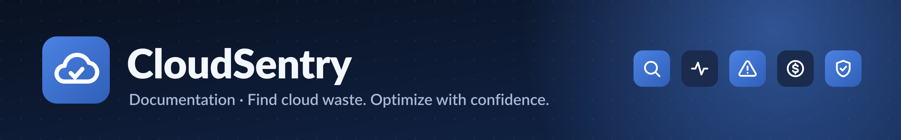

# Local development

## What runs locally

| Component             | Local implementation                                                                                                 | Deployed implementation             |
| --------------------- | -------------------------------------------------------------------------------------------------------------------- | ----------------------------------- |
| Database              | DynamoDB Local (`docker-compose.dev.yml`), table `cloudsentry-local`                                                 | DynamoDB `cloudsentry-<stage>-main` |
| Auth                  | `LocalIdentityProvider`: scrypt-hashed users in `.local/auth-users.json`, HS256 JWTs signed with `.local/jwt-secret` | Cognito user pool                   |
| Artifacts and reports | Filesystem under `.local/artifacts`, HMAC-signed download links                                                      | S3 with pre-signed URLs             |
| Scan workflow         | `InProcessScanStarter` runs the same step functions in the same order, emulating Parallel and Catch                  | Step Functions Standard workflow    |
| Schedules             | Stored, never executed                                                                                               | EventBridge Scheduler               |
| Notifications         | Written to the API log                                                                                               | SNS                                 |
| AWS APIs during scans | **Real**, with your local credentials                                                                                | Real, with Lambda execution roles   |

`LocalIdentityProvider` refuses to start unless `STAGE=local`, and `AUTH_MODE=local` is rejected by the API
composition root in any other stage. The CDK app always sets `AUTH_MODE=cognito`.

## Setup

```bash
pnpm install
pnpm dev:db
pnpm dev:api
pnpm dev:web
```

Optional `services/api/.env.local` (loaded by `pnpm dev:api`):

```bash
AWS_PROFILE=cloudsentry-dev     # credentials used for AssumeRole into customer roles and the Price List API
AWS_REGION=us-east-1
PLATFORM_ACCOUNT_ID=111111111111  # otherwise resolved with sts:GetCallerIdentity
LOG_LEVEL=debug
```

## Scanning a real account locally

1. In the dashboard, connect an account. CloudSentry shows a CloudFormation template whose trust policy
   trusts `PLATFORM_ACCOUNT_ID` (your local identity's account when unset) with the generated external ID.
2. Deploy the template in the target account (`aws cloudformation deploy ...` as shown).
3. Verify the connection, then start a scan. The scan runs inside the API process.

Your local principal needs `sts:AssumeRole` on `arn:aws:iam::*:role/CloudSentry*` and `pricing:GetProducts`.
AWS does not allow the root user to call `AssumeRole`, so local scans fail with root credentials.
Each scan makes up to four billed Cost Explorer requests (USD 0.01 each) unless a snapshot younger than
`COST_REFRESH_HOURS` (default 12) exists.

## Synthetic data

`pnpm seed:synthetic -- --email <you>` creates account `000000000000` with `dataSource = SYNTHETIC` and runs the
real detection, recommendation and persistence code over fabricated resources. Its cost snapshot has
`source = SYNTHETIC`. The dashboard shows a "Synthetic data" badge and a global banner, and cost cards say
"Includes SYNTHETIC sample data". The script only runs against DynamoDB Local. Savings for synthetic
resources are priced with the live Price List API when credentials are available.

## Resetting

```bash
docker compose -f docker-compose.dev.yml down   # DynamoDB Local is in-memory
rm -rf .local                                   # local users, JWT secret, artifacts
```
