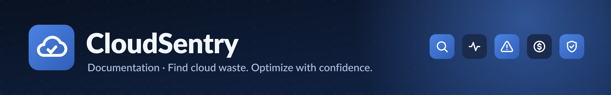

# Security overview

CloudSentry is read-only towards customer AWS accounts. This document lists the main threats and the controls
implemented for each. IAM details are in [iam.md](iam.md).

## Threats and controls

| Threat                                                                        | Controls                                                                                                                                                                                                                                                            | Where                                                                                          |
| ----------------------------------------------------------------------------- | ------------------------------------------------------------------------------------------------------------------------------------------------------------------------------------------------------------------------------------------------------------------- | ---------------------------------------------------------------------------------------------- |
| Theft of customer AWS credentials                                             | No permanent customer credentials exist. Customers deploy a role; CloudSentry assumes it per scan with STS. Temporary credentials live only in Lambda memory, are never persisted, logged, or passed between workflow states (each worker assumes the role itself). | `packages/aws-clients/src/credentials.ts`, `customer-clients.ts`                               |
| Confused deputy (another tenant tricks CloudSentry into reading your account) | External ID generated server-side (192 random bits) per registration and required by the trust policy; clients cannot choose it. Role must belong to the registered account ID (checked on input and via GetCallerIdentity).                                        | `core/src/accounts/account-service.ts`, `aws-clients/src/role-verifier.ts`                     |
| Over-privileged access in customer accounts                                   | Customer policy grants Describe/Get/List actions only; single source of truth in `shared-types/src/permissions.ts`; unit test asserts no mutating actions.                                                                                                          |                                                                                                |
| Over-privileged CloudSentry functions                                         | One Lambda per API domain and per workflow step; `sts:AssumeRole` limited to `arn:aws:iam::*:role/CloudSentry*` and only on functions that need it; no `dynamodb:Scan`; S3 limited to `scans/` and `reports/` prefixes.                                             | `infrastructure/constructs/grants.ts`, `policies/`                                             |
| Cross-tenant data access                                                      | Tenant resolved from the token subject via a server-side profile; every repository method takes `tenantId` and builds the partition key; forged pagination cursors rejected; foreign IDs return 404. Integration tests cover each path.                             | `packages/database`, `tests/integration/tenant-isolation.test.ts`, `api-authorization.test.ts` |
| Token theft via XSS                                                           | Refresh token only in an `HttpOnly; Secure; SameSite=Strict` cookie scoped to `/api/v1/auth`; access token held in memory only; strict security headers (CSP, HSTS, frame deny) from CloudFront.                                                                    | `services/api/src/http/cookies.ts`, `infrastructure/stacks/web-stack.ts`                       |
| CSRF                                                                          | SameSite=Strict cookie plus a required custom header on cookie-authenticated endpoints; all other endpoints use bearer tokens.                                                                                                                                      | `services/api/src/routes/auth.ts`                                                              |
| Forged or wrong-type JWTs                                                     | Gateway Cognito authorizer plus in-Lambda `aws-jwt-verify` with `tokenUse: access` and client ID check (rejects ID tokens and tokens from other app clients).                                                                                                       | `core/src/auth/cognito-identity-provider.ts`                                                   |
| Brute force / abuse                                                           | Cognito lockout and rate limits; API Gateway stage throttling; 64 KB body limit; strict Zod validation of every input.                                                                                                                                              |                                                                                                |
| Secrets in code or logs                                                       | Cognito client secret in Secrets Manager, fetched at runtime; logger redacts keys matching password/secret/token/credential/externalId/authorization/cookie; no secrets in the repo.                                                                                | `utilities/src/logger.ts`                                                                      |
| Data at rest / in transit                                                     | DynamoDB and S3 encrypted at rest; S3 Block Public Access, TLS-only bucket policy; SNS topic TLS enforced; reports downloaded via 5-minute pre-signed URLs keyed from the tenant's own record.                                                                      |                                                                                                |
| Accidental resource modification                                              | No code path calls a mutating AWS API on customer accounts; recommendations are advisory and status changes only update CloudSentry records.                                                                                                                        |                                                                                                |
| Misleading data                                                               | Estimates labelled as estimates with assumptions and price sources; missing metrics are `NO_DATA`, not zero; synthetic data is labelled in data and UI and can only be seeded into DynamoDB Local.                                                                  |                                                                                                |

## Audit logging

Mutating operations emit `audit: true` JSON log lines (`audit:<action>`) with tenant, user and target IDs:
user registration/login/logout, tenant provisioning, account create/update/verify/delete, scan start/cancel,
schedule create/update/delete, finding/recommendation status changes, settings changes, report request/download.
Query them in CloudWatch Logs Insights with `filter audit = 1`.

## Known limitations

- Tenant isolation is enforced in application code, not by IAM `dynamodb:LeadingKeys` conditions (that requires
  per-request scoped credentials; see iam.md "Tenant isolation limits").
- MFA is not yet supported in the sign-in flow.
- No WAF is attached to CloudFront or API Gateway by default.
- Dependency auditing runs via `pnpm audit:deps`; it is not yet wired into CI (no CI pipeline exists in this repo).
